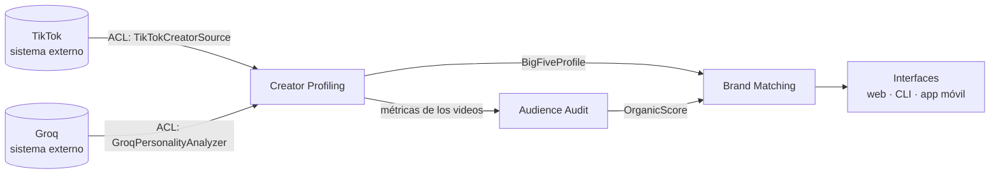
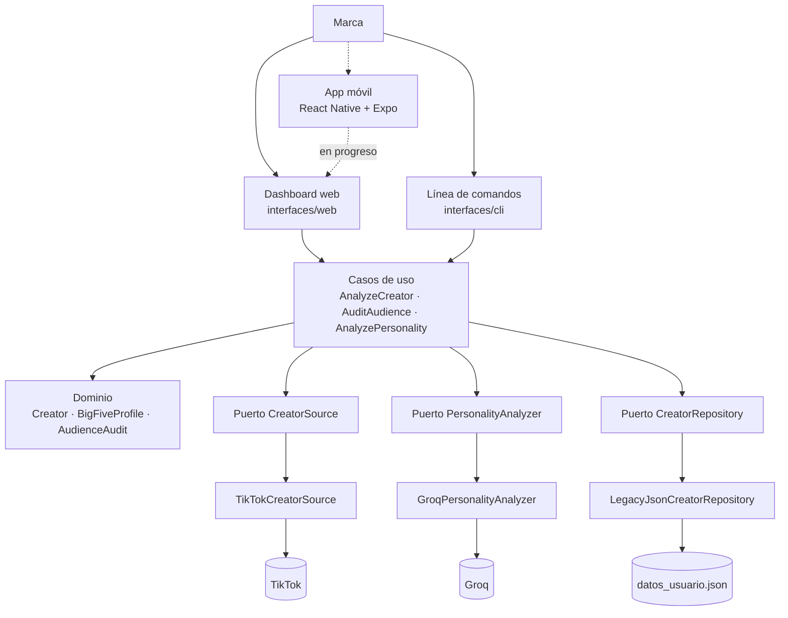
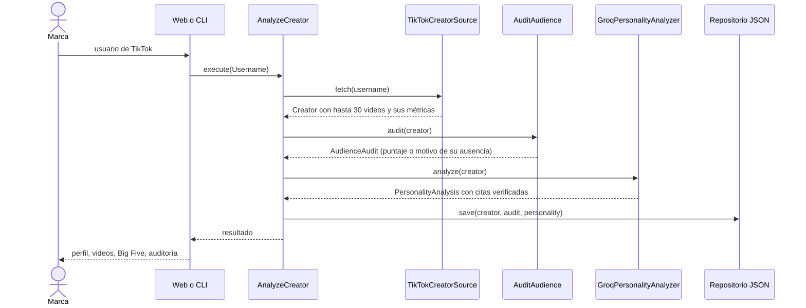
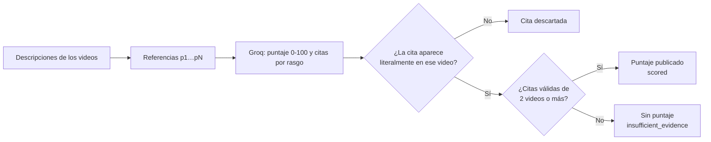

<div align="center">

# TrueMatch AI

### Inteligencia de creadores para marcas · TikTok Analytics con evidencia verificable

**Conecta marcas con creadores de TikTok usando datos, no intuición.**


**Proyecto académico · Universidad Central del Ecuador · Dispositivos Móviles · Grupo 5**

[Inicio rápido](#9-inicio-rápido) · [Arquitectura](#7-arquitectura) · [DDD](#6-metodología-domain-driven-design) · [Comandos](#10-comandos) · [Datos](#12-contrato-de-datos) · [Estado](#16-estado-del-proyecto) · [Defensa](#18-guía-para-la-defensa-técnica)

</div>

---

> Los resultados son estimaciones automáticas con fines educativos. No son un diagnóstico psicológico ni una auditoría certificada de audiencias.

## Contenido

1. [Presentación](#1-presentación)
2. [Integrantes](#2-integrantes)
3. [Problema](#3-problema)
4. [Modelo de negocio](#4-modelo-de-negocio)
5. [Prototipo en Figma](#5-prototipo-en-figma)
6. [Metodología: Domain-Driven Design](#6-metodología-domain-driven-design)
7. [Arquitectura](#7-arquitectura)
8. [Estructura del repositorio](#8-estructura-del-repositorio)
9. [Inicio rápido](#9-inicio-rápido)
10. [Comandos](#10-comandos)
11. [Cómo funciona cada módulo](#11-cómo-funciona-cada-módulo)
12. [Contrato de datos](#12-contrato-de-datos)
13. [Dashboard web y API](#13-dashboard-web-y-api)
14. [Aplicación móvil](#14-aplicación-móvil)
15. [Pruebas](#15-pruebas)
16. [Estado del proyecto](#16-estado-del-proyecto)
17. [Inteligencia artificial utilizada](#17-inteligencia-artificial-utilizada)
18. [Guía para la defensa técnica](#18-guía-para-la-defensa-técnica)
19. [Flujo de trabajo del equipo](#19-flujo-de-trabajo-del-equipo)
20. [Problemas comunes](#20-problemas-comunes)
21. [Limitaciones y consideraciones éticas](#21-limitaciones-y-consideraciones-éticas)
22. [Créditos y licencias](#22-créditos-y-licencias)

---

## 1. Presentación

**TrueMatch AI** analiza el perfil público de un creador de TikTok y entrega a una marca tres respuestas:

| Pregunta de la marca | Respuesta del sistema | Cómo se obtiene |
|---|---|---|
| ¿Quién es este creador? | Perfil Big Five con **citas literales** que respaldan cada rasgo, tono de comunicación e intereses | Modelo de lenguaje + verificación de citas en el dominio |
| ¿Su audiencia es real? | Auditoría estadística de sus métricas con la **Ley de Benford** | Cálculo matemático propio, sin IA |
| ¿Con qué sectores encaja? | Categorías de marca afines, con el motivo de cada una | Modelo de lenguaje sobre un catálogo cerrado |

### Principio de diseño

El sistema separa tres tipos de resultado y nunca los mezcla:

| Tipo | Ejemplo | Garantía |
|---|---|---|
| **Hecho observado** | 1 264 vistas, 38 me gusta | Entero exacto leído de TikTok, o `null` si no se conoce. Un dato ausente nunca se convierte en cero |
| **Cálculo matemático** | Distribución de primeros dígitos, MAD | Reproducible y cubierto por pruebas |
| **Interpretación generativa** | Apertura: 85 | Solo se publica si hay citas literales verificadas de al menos 2 videos distintos |

---

## 2. Integrantes

| Integrante | Rama | Aporte principal |
|---|---|---|
| Nicolás Caiza | `feature/nicolas` | Arranque en Expo Go, diseño DDD, backend en capas: motor de extracción, auditoría Benford, Big Five con evidencia, CLI |
| Daniel Valencia | `feature/daniel` | Proyecto original: scraper y enriquecimiento inicial; revisión y aprobación de pull requests |
| Jair Folleco | `feature/jair` | Dashboard web en Flask y su diseño |
| Karen García | `feature/karen` | Estructura académica y reporte de evidencia |

---

## 3. Problema

Las marcas y agencias de marketing invierten en creadores de contenido casi a ciegas:

- **El número de seguidores no dice si la audiencia es real.** Seguidores y "me gusta" pueden estar inflados, y la marca termina pagando por un alcance que no existe.
- **No hay una forma objetiva de saber si un creador encaja con la marca.** La decisión se toma por intuición o por popularidad, sin considerar su personalidad ni su tono.
- **Evaluar creadores a mano no escala.** Revisar perfiles uno por uno toma tiempo y cada persona usa criterios distintos.
- **Las herramientas de IA opinan sin mostrar de dónde sale su opinión.** Un puntaje sin evidencia no se puede auditar ni defender ante un cliente.

El resultado son campañas con bajo retorno y colaboraciones que no representan a la marca.

---

## 4. Modelo de negocio

| Elemento | Descripción |
|---|---|
| **Cliente** | Marcas, emprendimientos y agencias de marketing que contratan creadores de contenido |
| **Propuesta de valor** | Elegir creadores con datos trazables: personalidad con citas, autenticidad de audiencia y afinidad por sector, en un solo reporte |
| **Canal** | App móvil (React Native + Expo) y dashboard web |
| **Fuente de ingresos** | Suscripción mensual por planes según el número de creadores analizados, y pago por reporte individual |
| **Recursos clave** | Motor de extracción de datos públicos, modelo de IA, algoritmo de auditoría y de matching |
| **Diferenciador** | Cada afirmación sobre un creador enlaza al video que la respalda. Lo que no tiene evidencia se muestra como "Evidencia insuficiente", no como un número inventado |

---

## 5. Prototipo en Figma

**[Ver prototipo en Figma](https://www.figma.com/design/vhSjNmPShuKV5hoIjUKBZa/Prototipo-APP?node-id=0-1)**

| # | Pantalla | Qué hace la marca | Contexto del dominio |
|---|---|---|---|
| 1 | Front | Entra a la app | — |
| 2 | Onboarding | Ingresa el usuario de TikTok del creador | Creator Profiling |
| 3 | Loading | Espera mientras se analiza al creador | Creator Profiling |
| 4 | Dashboard | Ve el resumen: personalidad, audiencia y match | Los tres |
| 5 | Reporte | Revisa el detalle del análisis | Audience Audit · Brand Matching |
| 6 | Sectores | Consulta los sectores compatibles | Brand Matching |
| 7 | Propuesta | Envía una propuesta de colaboración | Brand Matching |

---

## 6. Metodología: Domain-Driven Design

Todo el backend se organiza alrededor del negocio y no de la tecnología. Las decisiones de esta sección mandan sobre el código: si un nombre o una regla cambia, se cambia primero aquí.

### 6.1 Dominio

> Ayudar a las marcas a encontrar creadores de TikTok que encajen con ellas, con base en quién es el creador, qué tan real es su audiencia y con qué sectores es compatible.

| Actor | Rol |
|---|---|
| **Marca** (`Brand`) | Usuario del sistema. Busca y evalúa creadores, y envía propuestas |
| **Creador** (`Creator`) | Persona con cuenta pública de TikTok que es analizada. No usa el sistema |

### 6.2 Subdominios

| Subdominio | Tipo | Por qué |
|---|---|---|
| Brand Matching | **Principal (core)** | Es lo que diferencia al producto |
| Creator Profiling | De soporte | Produce el perfil que alimenta al matching |
| Audience Audit | De soporte | Produce la medida de autenticidad que alimenta al matching |
| Extracción de datos de TikTok | Genérico | Se puede reemplazar por otra fuente sin cambiar el negocio |
| Proveedor de IA | Genérico | Se puede cambiar de proveedor sin cambiar el negocio |

### 6.3 Contextos acotados

| Contexto | Responsabilidad | No le corresponde | Estado |
|---|---|---|---|
| **Creator Profiling** | Obtener el perfil público y los videos, y estimar personalidad, tono e intereses con evidencia | Decidir si el creador conviene a una marca | Implementado |
| **Audience Audit** | Determinar qué tan orgánica es la audiencia a partir de sus métricas | Saber cómo se obtuvieron las métricas | Implementado |
| **Brand Matching** | Calcular afinidad por sector y puntaje de match, y gestionar propuestas | Calcular la personalidad o la autenticidad | En progreso |

### 6.4 Lenguaje ubicuo

El equipo usa estos términos, con este significado, en la documentación, en las conversaciones y en el código. Los nombres en código van en inglés.

| Término | En código | Significado | Contexto |
|---|---|---|---|
| Marca | `Brand` | Empresa o agencia que usa el sistema para buscar creadores | Brand Matching |
| Creador | `Creator` | Persona con cuenta pública de TikTok que la marca analiza. Raíz del agregado | Creator Profiling |
| Usuario | `Username` | Identificador del creador en TikTok, sin `@` | Creator Profiling |
| Perfil público | `PublicProfile` | Lo visible de la cuenta: seguidores, siguiendo y me gusta | Creator Profiling |
| Video | `Video` | Publicación del creador, con su descripción, enlace y fecha | Creator Profiling |
| Métricas del video | `VideoStats` | Vistas, me gusta, comentarios, compartidos y guardados. Cada una es un entero o desconocida | Creator Profiling |
| Perfil Big Five | `BigFiveProfile` | Los cinco rasgos de personalidad del creador y su resumen | Creator Profiling |
| Rasgo | `Trait` | Apertura, Responsabilidad, Extraversión, Amabilidad o Neuroticismo | Creator Profiling |
| Puntaje del rasgo | `TraitScore` | Entero de 0 a 100, independiente de los demás. Puede estar ausente | Creator Profiling |
| Evidencia del rasgo | `TraitEvidence` | Cita literal de la descripción de un video que respalda un rasgo | Creator Profiling |
| Estado del rasgo | `TraitStatus` | `scored`, `insufficient_evidence` o `invalid_score` | Creator Profiling |
| Análisis de personalidad | `PersonalityAnalysis` | Perfil Big Five, tono, intereses y afinidad comercial de un creador | Creator Profiling |
| Auditoría de audiencia | `AudienceAudit` | Revisión de las métricas del creador con la Ley de Benford | Audience Audit |
| Puntaje orgánico | `OrganicScore` | Resultado de la auditoría, de 0 a 100. Puede estar ausente | Audience Audit |
| Sector | `Sector` | Categoría de marca con la que se compara al creador | Brand Matching |
| Afinidad | `SectorAffinity` | Qué tanto encaja un creador con un sector | Brand Matching |
| Puntaje de match | `MatchScore` | Compatibilidad general entre una marca y un creador | Brand Matching |
| Propuesta | `Proposal` | Oferta de colaboración que la marca envía al creador | Brand Matching |

### 6.5 Mapa de contexto



| Relación | Tipo | Significado |
|---|---|---|
| Creator Profiling → Audience Audit | Proveedor / cliente | Profiling entrega las métricas; Audit las consume como valores sueltos, sin saber de dónde vienen |
| Creator Profiling → Brand Matching | Proveedor / cliente | Profiling entrega el perfil; Matching lo consume |
| Audience Audit → Brand Matching | Proveedor / cliente | Audit entrega el puntaje orgánico; Matching lo consume |
| TikTok → Creator Profiling | Capa anticorrupción (ACL) | Un adaptador traduce la página de TikTok a un `Creator`. Si TikTok cambia, solo cambia el adaptador |
| Groq → Creator Profiling | Capa anticorrupción (ACL) | Un adaptador traduce la respuesta del modelo a un `BigFiveProfile` y verifica cada cita. Cambiar de proveedor solo toca el adaptador |

### 6.6 Diseño táctico

**Capas y regla de dependencia**

```
interfaces  ──►  application  ──►  domain  ◄──  infrastructure
(web, CLI)       (casos de uso)    (negocio)    (TikTok, Groq, JSON)
```

- `domain` no depende de nada: solo usa la biblioteca estándar de Python.
- `application` solo conoce al dominio y define **puertos** (interfaces) para lo que necesita de afuera.
- `infrastructure` implementa esos puertos. Playwright, `requests` y `filelock` solo aparecen aquí.
- `interfaces` arma las dependencias y traduce entradas y salidas. No contiene reglas de negocio.

Esta regla se verifica analizando los imports de cada archivo: **no hay ninguna violación**.

**Bloques implementados**

| Contexto | Entidades | Objetos de valor | Servicios de dominio |
|---|---|---|---|
| Creator Profiling | `Creator` (raíz), `Video` | `Username`, `PublicProfile`, `VideoStats`, `TraitScore`, `TraitEvidence`, `BigFiveProfile`, `PersonalityAnalysis` | Verificación de citas (`verify_quotes`) |
| Audience Audit | `AudienceAudit` | `OrganicScore` | Análisis de Benford (`analyze_values`) |

**Casos de uso**

| Caso de uso | Qué hace | Quién lo usa |
|---|---|---|
| `AnalyzeCreator` | Fuente → auditoría → personalidad → repositorio. Si falla la IA, conserva la extracción y la auditoría | CLI `analyze`, web `/api/analizar` |
| `AuditAudience` | Junta las cinco métricas de todos los videos y las audita | `AnalyzeCreator`, CLI `audit` |
| `AnalyzePersonality` | Carga un creador ya guardado, lo analiza y guarda el resultado | CLI `bigfive` |

**Puertos y adaptadores**

| Puerto (`application/ports`) | Adaptador (`infrastructure`) | Tecnología |
|---|---|---|
| `CreatorSource` | `TikTokCreatorSource` | Playwright + motor SCRAPINGTIKTOK |
| `PersonalityAnalyzer` | `GroqPersonalityAnalyzer` | API de Groq por HTTP |
| `CreatorRepository` | `LegacyJsonCreatorRepository` | Archivos `datos_<usuario>.json` |

**Reglas del dominio (invariantes)**

| # | Regla | Dónde se aplica |
|---|---|---|
| 1 | Un `Username` tiene de 2 a 24 caracteres (letras, números, punto, guion bajo), sin `@`, y no puede estar formado solo por puntos | `Username` |
| 2 | Una métrica es un entero mayor o igual a cero, o desconocida. Lo desconocido nunca se convierte en cero | `VideoStats`, `PublicProfile` |
| 3 | Un `Creator` no tiene videos repetidos | `Creator` |
| 4 | Cada `TraitScore` es un entero de 0 a 100 | `TraitScore` |
| 5 | Los cinco rasgos son **independientes**: no se normalizan ni tienen que sumar 100 | `BigFiveProfile` |
| 6 | Una cita solo es válida si aparece literalmente en la descripción del video que cita | `TraitEvidence` |
| 7 | Un rasgo solo conserva su puntaje si tiene citas válidas de al menos **2 videos distintos** | `TraitAssessment` |
| 8 | El `OrganicScore` solo se calcula con al menos **110 valores válidos** que abarquen **2 órdenes de magnitud** | `AudienceAudit` |

---

## 7. Arquitectura

### 7.1 Vista general



### 7.2 Flujo de un análisis completo



Si el paso de la IA falla, el resultado se guarda igual con la extracción y la auditoría, y se informa el error. Si falla la extracción, no se guarda nada.

---

## 8. Estructura del repositorio

```
match-creadores_grupo5/
├── README.md
├── requirements.txt
├── .gitignore
├── backend/
│   ├── pyproject.toml
│   ├── tests/                              Pruebas trasplantadas de media-scraper
│   └── truematch/
│       ├── domain/                         Sin dependencias externas
│       │   ├── creator_profiling/
│       │   │   ├── username.py             Username
│       │   │   ├── counts.py               Regla "entero o desconocido"
│       │   │   ├── video.py                Video, VideoStats
│       │   │   ├── public_profile.py       PublicProfile
│       │   │   ├── creator.py              Creator (raíz del agregado)
│       │   │   ├── big_five.py             Trait, TraitScore, TraitStatus, BigFiveProfile
│       │   │   ├── trait_evidence.py       TraitEvidence, verificación de citas
│       │   │   └── personality_analysis.py PersonalityAnalysis
│       │   ├── audience_audit/
│       │   │   ├── benford.py              Análisis de Benford
│       │   │   ├── organic_score.py        OrganicScore y sus mínimos
│       │   │   └── audience_audit.py       AudienceAudit
│       │   └── brand_matching/             En progreso
│       ├── application/
│       │   ├── ports/
│       │   │   ├── creator_source.py
│       │   │   ├── personality_analyzer.py
│       │   │   └── creator_repository.py
│       │   └── use_cases/
│       │       ├── analyze_creator.py
│       │       ├── audit_audience.py
│       │       └── analyze_personality.py
│       ├── infrastructure/
│       │   ├── config.py                   Configuración: clave, modelo, carpetas
│       │   ├── tiktok/
│       │   │   ├── session.py              Sesión persistente de Chromium con bloqueo
│       │   │   ├── runtime.py              Controles de acceso e identidad
│       │   │   ├── adapter.py              Salida del motor → contrato propio
│       │   │   ├── tiktok_creator_source.py  Capa anticorrupción → Creator
│       │   │   └── vendor/scrapingtiktok/  Motor de terceros (MIT), con su licencia
│       │   ├── ai/
│       │   │   ├── groq_client.py          Cliente HTTP de Groq
│       │   │   ├── prompts.py              Prompt con referencias p1…pN
│       │   │   ├── json_extractor.py
│       │   │   └── groq_personality_analyzer.py  Capa anticorrupción → BigFiveProfile
│       │   └── persistence/
│       │       └── legacy_json_repository.py     datos_<usuario>.json
│       └── interfaces/
│           ├── cli/
│           │   ├── main.py                 Subcomandos
│           │   └── formatting.py           Salida de consola
│           └── web/
│               ├── app.py                  Servidor Flask
│               └── templates/index.html    Dashboard
└── mobile/                                 App TrueMatch AI (Expo)
    ├── App.tsx
    ├── index.ts
    ├── app.json · package.json · tsconfig.json
    ├── assets/
    └── src/
        ├── screens/                        Las 7 pantallas del prototipo
        ├── components/
        └── theme.ts
```

En la raíz no hay ningún script de Python: todo el backend se ejecuta desde dentro de la estructura.

---

## 9. Inicio rápido

### 9.1 Requisitos

| Requisito | Para qué |
|---|---|
| Python 3.10 o superior | Backend |
| Node.js LTS y la app Expo Go en el teléfono | App móvil |
| Cuenta de TikTok | Iniciar la sesión que usa el motor de extracción |
| Clave de Groq ([console.groq.com](https://console.groq.com)) | Análisis de personalidad |

### 9.2 Instalación del backend

```bash
git clone https://github.com/DanielValenc/match-creadores_grupo5.git
cd match-creadores_grupo5

python3 -m venv venv
source venv/bin/activate            # Windows: venv\Scripts\activate

pip install -r requirements.txt
python -m playwright install chromium
```

### 9.3 Configuración

Crea un archivo `.env` en la raíz del repositorio:

```
GROQ_API_KEY=tu_clave_aqui
GROQ_MODEL=qwen/qwen3.8-27b
```

| Variable | Obligatoria | Descripción |
|---|---|---|
| `GROQ_API_KEY` | Sí, para el análisis de personalidad | Clave de la API de Groq |
| `GROQ_MODEL` | No | Modelo a usar. Tiene un valor por defecto |
| `TRUEMATCH_DATA_DIR` | No | Carpeta donde se guardan los `datos_<usuario>.json`. Por defecto, la raíz del repositorio |
| `TRUEMATCH_PRIVATE_DIR` | No | Carpeta de la sesión de Chromium. Por defecto, `.truematch/` |

> `.env`, `.truematch/` y `datos_*.json` están en `.gitignore`. Nunca se suben al repositorio.

### 9.4 Primer análisis

Todos los comandos del backend se ejecutan **desde `backend/`** y con el entorno virtual activo.

```bash
cd backend

# 1. Una sola vez: iniciar sesión en TikTok. Se abre Chromium; al terminar, pulsa ENTER en la terminal.
python -m truematch.interfaces.cli.main session

# 2. Analizar un creador: extracción + auditoría + Big Five
python -m truematch.interfaces.cli.main analyze <usuario>

# 3. Ver el resultado en el dashboard
python -m truematch.interfaces.cli.main web
```

Abre `http://127.0.0.1:5000/?usuario=<usuario>`.

---

## 10. Comandos

Prefijo de todos: `python -m truematch.interfaces.cli.main`

| Comando | Qué hace | TikTok | Groq |
|---|---|:-:|:-:|
| `session` | Abre Chromium para iniciar sesión manualmente y guarda la sesión | Sí | No |
| `analyze <usuario>` | Extracción de hasta 30 videos, auditoría y Big Five | Sí | Sí |
| `analyze <usuario> --sin-analisis` | Extracción y auditoría, sin IA | Sí | No |
| `bigfive <usuario> [<usuario> ...]` | Big Five sobre creadores ya extraídos | No | Sí |
| `bigfive --todos` | Big Five sobre todos los `datos_*.json` | No | Sí |
| `bigfive --listar-modelos` | Lista los modelos disponibles en la cuenta de Groq | No | Sí |
| `audit <usuario>` | Auditoría de Benford sobre un creador ya extraído | No | No |
| `web [--host H] [--port P]` | Levanta el dashboard en `http://127.0.0.1:5000` | Al analizar | Al analizar |

Los comandos terminan con código de salida `1` cuando algo falla.

**Ejemplo de salida de `analyze`**

```
Perfil @ejemplo: 2.126 seguidores · 1.221 siguiendo · 260.801 me gusta
 #  Fecha       Vistas  Likes  Coment.  Compart.  Guard.  Descripción
--  ----------  ------  -----  -------  --------  ------  ----------------------------------------
 1  2026-10-23   1.264     38        2         4       2  Gracias por generar esta necesidad! #via…
 2  2025-05-10   9.507    913       14        24      69  Mi primer concierto! #starwars
18 videos

Big Five: Apertura 85 · Responsabilidad — · Extraversion 75 · Amabilidad 80 · Neuroticismo 30

Auditoría de audiencia: sin puntaje (76 valores válidos de 110 necesarios)
```

---

## 11. Cómo funciona cada módulo

### 11.1 Extracción de TikTok

| Aspecto | Implementación |
|---|---|
| Motor | SCRAPINGTIKTOK (licencia MIT), integrado en `infrastructure/tiktok/vendor/` con su licencia y registro de procedencia |
| Navegador | Chromium controlado por Playwright, en modo oculto |
| Sesión | Perfil persistente en `.truematch/chromium`, iniciado una vez con el comando `session` |
| Concurrencia | Un bloqueo entre procesos (`filelock`) impide dos extracciones simultáneas sobre la misma sesión. Funciona en Linux, macOS y Windows |
| Alcance | Hasta 30 videos por creador |
| Datos por video | Identificador, enlace, descripción, fecha de publicación, vistas, me gusta, comentarios, compartidos y guardados |
| Tiempo | De 2 a 3 minutos, porque el motor abre cada video |
| Lo que **no** recoge | Listas de seguidores y seguidos, ni el texto de los comentarios. El motor se parcheó para omitirlos: no se necesitan y son datos de terceros |

**Garantías de la capa anticorrupción**

- Verifica que el perfil devuelto sea el solicitado y que cada video pertenezca a ese perfil.
- Un video al que no se pudo acceder se omite; no se rellena con datos inventados.
- Si TikTok pide verificación o inicio de sesión, la extracción se detiene y se indica ejecutar `session`. No se intenta resolver ni evadir verificaciones.
- "Hasta 30 videos" es un límite, no una garantía: el resultado puede ser parcial y así se informa.

### 11.2 Big Five con evidencia verificada

El modelo de lenguaje propone; el dominio decide qué se publica.



| Paso | Detalle |
|---|---|
| Referencias cortas | Cada video se envía como `p1…pN`, para que el modelo no invente identificadores |
| Solicitud | Por rasgo: un puntaje de 0 a 100 y citas literales breves |
| Verificación | La cita se compara con la descripción original. Solo se toleran diferencias de espacios y de composición Unicode; no hay coincidencias aproximadas |
| Regla de publicación | Citas válidas de al menos 2 videos distintos. Si no, el rasgo queda sin puntaje |
| Cobertura | Se informa en cuántos videos hay evidencia. La cobertura nunca se usa como puntaje: no tener señales no significa tener el rasgo bajo |
| Resumen | Es texto libre del modelo y **no está verificado**; así se rotula en la consola y en la web |

**Estados de un rasgo**

| Estado | Significado | Qué muestra la interfaz |
|---|---|---|
| `scored` | Puntaje respaldado por citas de 2 o más videos | El puntaje y sus citas, cada una enlazada a su video |
| `insufficient_evidence` | No hay citas válidas suficientes | "Evidencia insuficiente" |
| `invalid_score` | Hay citas, pero el modelo no dio un número utilizable | "Puntaje no válido" |

### 11.3 Auditoría de audiencia con la Ley de Benford

En muchos conjuntos de datos naturales, el primer dígito no se reparte por igual: el 1 aparece cerca del 30 % de las veces y el 9 menos del 5 %. La distribución esperada es:

$$P(d) = \log_{10}\left(1 + \frac{1}{d}\right), \qquad d = 1, \dots, 9$$

| Dígito | 1 | 2 | 3 | 4 | 5 | 6 | 7 | 8 | 9 |
|---|---|---|---|---|---|---|---|---|---|
| Esperado | 30,1 % | 17,6 % | 12,5 % | 9,7 % | 7,9 % | 6,7 % | 5,8 % | 5,1 % | 4,6 % |

**Procedimiento**

1. Se juntan las cinco métricas de todos los videos (hasta 150 valores con 30 videos).
2. Se excluyen los valores ausentes y los ceros, y se informa cuántos de cada tipo.
3. Se toma el primer dígito significativo de cada valor y se calcula la distribución observada.
4. Se mide la desviación con la **MAD** (desviación absoluta media) frente a la distribución esperada.
5. Se guardan las advertencias y el aviso de interpretación.

**Cuándo hay puntaje**

| Condición | Motivo |
|---|---|
| Al menos 110 valores válidos | Con menos, algún recuento esperado es menor que 5 y la comparación no es fiable |
| Al menos 2 órdenes de magnitud | Benford solo aplica a datos que abarcan varias escalas |

Si no se cumplen, el resultado es "Sin puntaje" con el motivo exacto. No se inventa un número.

> **En revisión:** la conversión de la MAD al puntaje de 0 a 100 penaliza las muestras pequeñas, de modo que con 110 a 150 valores una cuenta auténtica obtiene un puntaje bajo. La distribución, las advertencias y la MAD son correctas; el puntaje orgánico debe tratarse como provisional hasta recalibrarlo contra la desviación esperada por azar para cada tamaño de muestra.

> **Interpretación:** una desviación respecto de Benford no demuestra bots, fraude ni compra de seguidores, y una distribución cercana tampoco demuestra autenticidad. Es un indicio estadístico.

---

## 12. Contrato de datos

Cada análisis se guarda en `datos_<usuario>.json`. El dashboard y la API devuelven este mismo documento.

```json
{
  "usuario": "ejemplo",
  "perfil": {
    "foto_perfil": "https://...",
    "siguiendo": 1221,
    "seguidores": 2126,
    "me_gusta": 260801
  },
  "videos_recientes": [
    {
      "posicion": 1,
      "id": "7699994855979633928",
      "enlace": "https://www.tiktok.com/@ejemplo/video/7699994855979633928",
      "miniatura": "https://...",
      "descripcion": "Texto de la publicación #hashtag",
      "fecha_publicacion": "2026-10-23T22:32:47+00:00",
      "vistas": 1264,
      "me_gusta": 38,
      "comentarios": 2,
      "compartidos": 4,
      "guardados": 2,
      "estado": "Extraído exitosamente"
    }
  ],
  "analisis_bigfive": {
    "Apertura": 85,
    "Responsabilidad": null,
    "Extraversion": 75,
    "Amabilidad": 80,
    "Neuroticismo": 30,
    "resumen": "Texto generado por IA, no verificado."
  },
  "analisis_bigfive_evidencia": {
    "videos_analizados": 18,
    "citas_descartadas": 0,
    "minimo_videos_por_rasgo": 2,
    "rasgos": {
      "Apertura": {
        "puntaje": 85,
        "estado": "scored",
        "videos_con_evidencia": 3,
        "cobertura_evidencia": 17,
        "evidencias": [
          { "video_id": "7502953069521456439", "cita": "Fragmento literal de la descripción" }
        ]
      },
      "Responsabilidad": {
        "puntaje": null,
        "estado": "insufficient_evidence",
        "videos_con_evidencia": 0,
        "cobertura_evidencia": 0,
        "evidencias": []
      }
    }
  },
  "perfil_comercial": {
    "tono_comunicacion": "cercano, entusiasta y humorístico",
    "intereses": ["Lectura", "Viajes"],
    "afinidad_marcas": [
      { "categoria": "Viajes y turismo", "motivo": "Documenta viajes con frecuencia." }
    ]
  },
  "auditoria_audiencia": {
    "puntaje_organico": null,
    "metricas": ["vistas", "me_gusta", "comentarios", "compartidos", "guardados"],
    "tamano_muestra": 76,
    "registros_totales": 90,
    "excluidos": { "missing": 0, "zero": 14, "negative": 0, "invalid": 0 },
    "mad": 0.0347,
    "ordenes_de_magnitud": 5,
    "distribucion": [
      { "digito": 1, "observados": 25, "esperados": 22.88, "observado_porcentaje": 32.89, "esperado_porcentaje": 30.10 }
    ],
    "advertencias": ["Muestra reducida: ..."],
    "disclaimer": "Una desviación respecto de Benford no demuestra bots, fraude ni compra de seguidores."
  }
}
```

*Documento de ejemplo con valores ilustrativos.*

| Convención | Significado |
|---|---|
| Número entero | Valor leído de TikTok |
| `null` en una métrica | El dato no se pudo conocer. No equivale a cero |
| `null` en un rasgo | No hubo evidencia suficiente. No equivale a un rasgo bajo |
| `null` en `puntaje_organico` | La muestra no alcanza los mínimos. El motivo está en `tamano_muestra` y `advertencias` |

---

## 13. Dashboard web y API

```bash
cd backend
python -m truematch.interfaces.cli.main web
```

### 13.1 Qué muestra el dashboard

| Sección | Contenido |
|---|---|
| Perfil | Foto, usuario, seguidores, siguiendo y me gusta |
| Big Five | Barra por rasgo con su puntaje o "Evidencia insuficiente"; gráfico de radar solo con los rasgos puntuados; citas desplegables enlazadas a cada video; cantidad de citas descartadas |
| Perfil comercial | Tono de comunicación, intereses y categorías de marca afines con su motivo |
| Auditoría de audiencia | Puntaje o "Sin puntaje" con el motivo; gráfico de dígitos observados frente a los esperados; advertencias y aviso de interpretación |
| Videos | Todos los videos extraídos, con fecha y sus cinco métricas |

### 13.2 Endpoints

| Método | Ruta | Función | TikTok y Groq |
|---|---|---|:-:|
| `GET` | `/` | Dashboard. Con `?usuario=<usuario>` carga un resultado ya guardado | No |
| `GET` | `/api/health` | Estado del servicio | No |
| `GET` | `/api/datos/<usuario>` | Devuelve el resultado guardado de un creador | No |
| `POST` | `/api/analizar` | Ejecuta `AnalyzeCreator` y devuelve el resultado. Cuerpo: `{"username": "<usuario>"}` | Sí |

### 13.3 Respuestas de error

| Situación | HTTP |
|---|:-:|
| Usuario inválido | 400 |
| No existe un resultado guardado para ese usuario | 404 |
| Ya hay una extracción en curso | 409 |
| TikTok pide verificación o inicio de sesión, o el perfil no coincide | 502 |
| Falla el proveedor de IA (la extracción y la auditoría quedan guardadas) | 502 |
| Falta `GROQ_API_KEY` (se detecta antes de abrir TikTok) | 503 |
| Error inesperado | 500 |

---

## 14. Aplicación móvil

App **TrueMatch AI** en React Native con Expo, basada en el prototipo de Figma.

```bash
cd mobile
npm install
npx expo start
```

Escanea el código QR con Expo Go (Android) o con la cámara (iOS). El teléfono y la computadora deben estar en la misma red wifi.

| Aspecto | Estado |
|---|---|
| Arranque en Expo Go (SDK 58) | Funciona |
| Navegación entre las 7 pantallas del prototipo | Funciona |
| Datos mostrados | Valores de ejemplo escritos en el código. La conexión con el backend está en progreso |
| Estructura en capas DDD | En progreso. El diseño está definido en la sección 6 |

---

## 15. Pruebas

```bash
cd backend
python -m unittest tests.test_benford tests.test_reference_engine   # 12 pruebas, sin red ni navegador
python -m unittest discover -s tests                                # añade la prueba de sesión, que abre Chromium oculto sin red
```

| Archivo | Qué comprueba |
|---|---|
| `test_benford.py` | Probabilidades teóricas, primer dígito significativo sin errores de redondeo, MAD y χ² con recuentos conocidos, exclusiones separadas, muestra vacía y límites de muestra pequeña |
| `test_reference_engine.py` | Que la copia del motor de terceros y su licencia MIT se conservan intactas (por hash), que un fallo nunca se convierte en un perfil vacío, que se rechazan perfiles y videos ajenos, y que el bloqueo de sesión se mantiene |
| `test_browser.py` | Que la sesión persistente conserva cookies y almacenamiento local entre ejecuciones |

Las pruebas provienen del proyecto media-scraper y se trajeron junto con el código que verifican.

---

## 16. Estado del proyecto

| Parte | Estado |
|---|---|
| Extracción de perfil y hasta 30 videos con sus cinco métricas | ✅ Funciona con perfiles reales |
| Big Five con citas literales verificadas, sin normalizar | ✅ Funciona con perfiles reales |
| Auditoría de Benford: distribución, MAD, advertencias y mínimos | ✅ Funciona |
| Backend en capas DDD, sin scripts fuera de la estructura y sin violaciones de dependencia | ✅ Completo |
| Línea de comandos: `session`, `analyze`, `bigfive`, `audit`, `web` | ✅ Funciona |
| Dashboard web conectado: métricas por video, citas por rasgo y auditoría | ✅ Funciona |
| App en Expo Go con las 7 pantallas del prototipo | ✅ Funciona como maqueta navegable |
| Conversión de la MAD a puntaje orgánico | 🚧 En recalibración (ver 11.3) |
| Brand Matching: afinidad numérica por sector, criterios y puntaje de match | 🚧 En progreso |
| App móvil consumiendo datos reales del backend | 🚧 En progreso |
| App móvil en capas DDD | 🚧 En progreso |
| Envío de propuestas | 🚧 En progreso |

---

## 17. Inteligencia artificial utilizada

**Dentro del producto**

| IA | Uso | Control aplicado |
|---|---|---|
| API de Groq (modelo Qwen, configurable) | Propone el puntaje de cada rasgo del Big Five con citas, el resumen, el tono, los intereses y las categorías de marca afines | Cada cita se verifica contra el texto original. Las categorías se filtran contra un catálogo cerrado. El resumen se rotula como no verificado |

Al modelo solo se envían las descripciones de los videos. No se envían comentarios de terceros ni métricas.

**Durante el desarrollo**

| IA | Uso |
|---|---|
| Claude (Anthropic) | Análisis del proyecto frente a la consigna, diseño estratégico y táctico de DDD, planificación de la migración por pasos, revisión de cada cambio antes de confirmarlo y redacción de la documentación |
| Claude Code | Análisis del repositorio desde la terminal y aplicación de los cambios en el código. Cada cambio fue revisado y confirmado manualmente por el equipo, un commit por paso |

Los prompts utilizados y sus resultados están documentados en el reporte de evidencia.

---

## 18. Guía para la defensa técnica

| Pregunta probable | Respuesta corta | Dónde mostrarlo |
|---|---|---|
| ¿Dónde está aplicado DDD? | En todo el backend: cuatro capas, tres contextos acotados, lenguaje ubicuo en el código y regla de dependencias verificada | Sección 6 y `backend/truematch/` |
| ¿Cómo prueban que el dominio no depende de la tecnología? | `domain` y `application` solo importan la biblioteca estándar. Playwright y `requests` solo aparecen en `infrastructure` | Imports de `domain/` |
| ¿Qué pasa si TikTok cambia su página? | Solo cambia el adaptador `TikTokCreatorSource`. El dominio y los casos de uso no se tocan | `infrastructure/tiktok/` |
| ¿Y si cambian de proveedor de IA? | Se escribe otro adaptador del puerto `PersonalityAnalyzer` | `application/ports/personality_analyzer.py` |
| ¿Cómo saben que la IA no inventa? | Cada cita se busca literalmente en la descripción del video. Si no aparece, se descarta. Sin citas de 2 videos, no hay puntaje | `domain/creator_profiling/trait_evidence.py` |
| ¿Por qué un rasgo sale vacío? | Porque no hubo evidencia suficiente. Mostrar "Evidencia insuficiente" es más correcto que un número sin respaldo | Dashboard, sección Big Five |
| ¿Por qué los rasgos no suman 100? | En el modelo Big Five los rasgos son independientes; cada uno va de 0 a 100 | Invariante 5 |
| ¿Qué es la Ley de Benford y por qué aquí? | Describe cómo se reparten los primeros dígitos en datos naturales. Métricas infladas artificialmente tienden a desviarse de ese patrón | Sección 11.3 |
| ¿Por qué a veces no hay puntaje orgánico? | Con menos de 110 valores la comparación no es fiable, y el sistema prefiere no dar un número | `domain/audience_audit/organic_score.py` |
| ¿Benford demuestra seguidores falsos? | No. Es un indicio estadístico, y así se advierte en cada resultado | Aviso de interpretación |
| ¿De dónde salió el scraper? | De un motor de terceros con licencia MIT, integrado con su licencia y registro de procedencia, y adaptado mediante una capa anticorrupción | `infrastructure/tiktok/vendor/scrapingtiktok/` |
| ¿Por qué archivos JSON y no una base de datos? | El repositorio es un puerto. Cambiar a una base de datos es escribir otro adaptador, sin tocar el dominio | `application/ports/creator_repository.py` |
| ¿Qué diferencia hay entre un cero y un dato vacío? | Un cero es un valor observado; un dato vacío es desconocido. Mezclarlos falsearía la auditoría | Invariante 2 |

**Demostración sugerida**

1. Mostrar la estructura de carpetas y la regla de dependencias.
2. Abrir el dashboard con un creador ya analizado (`/?usuario=<usuario>`), para no depender de TikTok en vivo.
3. Desplegar las citas de un rasgo y abrir el video que respalda una de ellas.
4. Mostrar un rasgo con "Evidencia insuficiente" y explicar la regla de los 2 videos.
5. Mostrar la auditoría: gráfico de dígitos y motivo del puntaje o de su ausencia.
6. Abrir la app en Expo Go y recorrer las pantallas del prototipo.

---

## 19. Flujo de trabajo del equipo

| Rama | Uso |
|---|---|
| `main` | Versión de entrega. Protegida: solo recibe cambios desde `dev` |
| `dev` | Integración. Protegida: todo entra por pull request con una aprobación |
| `feature/<nombre>` | Trabajo de cada integrante |

**Pasos**

1. Trae lo último de `dev` a tu rama: `git pull origin dev`
2. Trabaja y haz commits pequeños con Conventional Commits, uno por cambio verificado.
3. Sube tu rama: `git push origin feature/<nombre>`
4. Abre un pull request hacia `dev` y solicita la revisión.

| Tipo | Cuándo | Ejemplo |
|---|---|---|
| `feat` | Funcionalidad nueva | `feat(domain): OrganicScore y AudienceAudit` |
| `fix` | Corrección de un error | `fix(domain): Username rechaza usuarios formados solo por puntos` |
| `refactor` | Reorganizar sin cambiar el comportamiento | `refactor(web): mover la web a interfaces/web` |
| `docs` | Documentación | `docs(readme): arquitectura DDD y comandos` |
| `chore` | Configuración, dependencias y limpieza | `chore(deps): filelock` |

---

## 20. Problemas comunes

| Problema | Causa probable | Solución |
|---|---|---|
| `No module named 'truematch'` | El comando se ejecutó fuera de `backend/` | `cd backend` y repetir |
| `No module named 'playwright'` o `'flask'` | El entorno virtual no está activo | `source venv/bin/activate` |
| "No se pudo extraer el perfil" a los pocos segundos | El usuario no existe con ese nombre exacto o la cuenta es privada | Verificar el usuario en TikTok |
| TikTok solicita verificación o autenticación | La sesión caducó | Ejecutar el comando `session` |
| "La sesión está en uso" | Hay otra extracción o un `session` abierto | Esperar a que termine o cerrarlo |
| `Port 5000 is in use` | Quedó un servidor web abierto | Cerrarlo o usar `web --port 8080` |
| Todos los rasgos con "Evidencia insuficiente" | El creador casi no escribe descripciones | Es el resultado correcto: no hay texto que analizar |
| Auditoría "sin puntaje" | Menos de 110 valores válidos | Es el resultado correcto para cuentas con pocos videos |
| Falta `GROQ_API_KEY` | No existe el archivo `.env` en la raíz | Crearlo como indica la sección 9.3 |
| Error 401 de la API | Clave de Groq inválida | Generar una nueva clave |
| Error 404 `model_not_found` | La cuenta no tiene acceso a ese modelo | `bigfive --listar-modelos` y cambiar `GROQ_MODEL` |
| Expo Go no carga la app | El teléfono y la computadora están en redes distintas | Misma wifi, o `npx expo start --tunnel` |

---

## 21. Limitaciones y consideraciones éticas

**Limitaciones técnicas**

- **El análisis de personalidad solo usa texto.** Se basa en las descripciones de los videos, no en el audio ni en la imagen. Un creador que no escribe descripciones no puede ser perfilado.
- **No es un test psicométrico.** El Big Five aquí es una estimación a partir de pocas publicaciones. Los valores son orientativos.
- **Muestra limitada.** Se analizan hasta 30 videos, y la extracción puede ser parcial.
- **Cifras redondeadas.** TikTok entrega redondeadas las métricas superiores a diez mil. No afecta a la auditoría, que solo usa el primer dígito.
- **Las métricas de un mismo video no son independientes entre sí.** Juntar las cinco para la auditoría es una decisión práctica para alcanzar el tamaño mínimo de muestra.
- **Puntaje orgánico provisional.** Ver la nota de la sección 11.3.
- **Dependencia de la sesión.** La extracción requiere una sesión de TikTok iniciada manualmente, que puede caducar.

**Consideraciones éticas**

- **Solo datos públicos.** Se consultan cuentas públicas. No se recogen listas de seguidores ni comentarios de terceros.
- **Sin evasión de controles.** El sistema no resuelve ni elude verificaciones de TikTok; cuando aparecen, se detiene.
- **Decisiones humanas.** Los resultados son un apoyo. No deben tomarse decisiones sobre una persona solo con estas estimaciones.
- **Términos de uso.** La extracción automatizada puede ir contra los términos de TikTok. El uso de este proyecto es académico.
- **Datos enviados a terceros.** Las descripciones de los videos se envían a la API de Groq para su análisis.
- **Datos locales.** Los resultados y la sesión se guardan solo en el equipo de quien ejecuta el sistema y están excluidos del repositorio.

---

## 22. Créditos y licencias

| Componente                                                                  | Origen | Licencia |
|-----------------------------------------------------------------------------|--|--|
| Motor de extracción SCRAPINGTIKTOK                                          | Jccasav, integrado en `backend/truematch/infrastructure/tiktok/vendor/scrapingtiktok/` | MIT. Se conservan `LICENSE`, `PROVENANCE.json` e `INTEGRATION.patch` con los cambios aplicados |
| Análisis de Benford, sesión persistente, adaptador del motor y pruebas      | Proyecto media-scraper de Nicolás Caiza | Trasplantado con nota de origen en cada archivo |
| Scraper inicial, enriquecimiento Big Five y prototipo de la app             | Daniel Valencia | Base del proyecto |
| Dashboard web                                                               | Jair Folleco | Diseño e interfaz |
| Reporte final, documentación académica, metodológica y pruebas de escritorio | Karen García | Autoría y documentación del proyecto |

---

<div align="center">

**Universidad Central del Ecuador · Dispositivos Móviles · Grupo 5**

Nicolás Caiza · Daniel Valencia · Jair Folleco · Karen García

</div>
