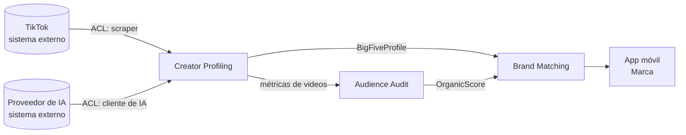

# TrueMatch AI

**Conecta marcas con creadores de TikTok usando evidencia, no intuición.**

TrueMatch AI analiza el perfil público de un creador de contenido, estima su personalidad con el modelo Big Five, audita qué tan real es su audiencia y calcula con qué sectores de marca encaja mejor. La marca recibe ese resultado en una app móvil y puede enviarle una propuesta de colaboración.

> Proyecto académico · Universidad Central del Ecuador (UCE) · Materia: Dispositivos Móviles · Grupo 5
> Los resultados son estimaciones automáticas con fines educativos. No son un diagnóstico psicológico ni una auditoría certificada.

---

## Contenido

1. [Integrantes](#1-integrantes)
2. [Problema](#2-problema)
3. [Modelo de negocio](#3-modelo-de-negocio)
4. [Solución](#4-solución)
5. [Prototipo en Figma](#5-prototipo-en-figma)
6. [Metodología: Domain-Driven Design](#6-metodología-domain-driven-design)
7. [Estructura del proyecto](#7-estructura-del-proyecto)
8. [Tecnologías](#8-tecnologías)
9. [Instalación y ejecución](#9-instalación-y-ejecución)
10. [Inteligencia artificial utilizada](#10-inteligencia-artificial-utilizada)
11. [Flujo de trabajo del equipo](#11-flujo-de-trabajo-del-equipo)
12. [Estado del proyecto](#12-estado-del-proyecto)
13. [Problemas comunes](#13-problemas-comunes)
14. [Limitaciones y consideraciones éticas](#14-limitaciones-y-consideraciones-éticas)

---

## 1. Integrantes

| Integrante | Rama | Responsabilidad |
|---|---|---|
| Nicolás Caiza | `feature/nicolas` | Arranque en Expo Go, diseño DDD y arquitectura de la app móvil |
| Daniel Valencia | `feature/daniel` | Backend: scraping, enriquecimiento Big Five y API |
| Jair Folleco | `feature/jair` | Documentación y prototipo en Figma |
| Karen García | `feature/karen` | Estructura académica y reporte de evidencia (PDF) |

---

## 2. Problema

Las marcas y agencias de marketing invierten en creadores de contenido casi a ciegas:

- **El número de seguidores no dice si la audiencia es real.** Seguidores y "me gusta" pueden estar inflados, y la marca termina pagando por un alcance que no existe.
- **No hay una forma objetiva de saber si un creador encaja con la marca.** La decisión se toma por intuición o por popularidad, sin considerar la personalidad ni el tono del creador.
- **Evaluar creadores a mano no escala.** Revisar perfiles uno por uno toma tiempo y cada persona lo hace con criterios distintos.

El resultado son campañas con bajo retorno y colaboraciones que no representan a la marca.

---

## 3. Modelo de negocio

| Elemento | Descripción |
|---|---|
| **Cliente** | Marcas, emprendimientos y agencias de marketing que contratan creadores de contenido |
| **Propuesta de valor** | Elegir creadores con datos: personalidad estimada, autenticidad de la audiencia y afinidad por sector, en un solo reporte |
| **Canal** | App móvil (React Native + Expo) |
| **Fuente de ingresos** | Suscripción mensual por planes según el número de creadores analizados, y pago por reporte individual |
| **Recursos clave** | Pipeline de extracción de datos públicos, modelo de IA para el enriquecimiento, algoritmo de auditoría y de matching |
| **Diferenciador** | Combina personalidad (Big Five) y autenticidad de audiencia (Ley de Benford) en un puntaje de compatibilidad por sector |

---

## 4. Solución

```
Marca ingresa un usuario de TikTok
        │
        ▼
1. Extracción      Perfil público y videos recientes del creador
        │
        ▼
2. Enriquecimiento Personalidad Big Five, tono e intereses (IA)
        │
        ▼
3. Auditoría       Autenticidad de la audiencia (Ley de Benford)
        │
        ▼
4. Matching        Afinidad por sector y puntaje de match
        │
        ▼
5. Propuesta       La marca contacta al creador desde la app
```

| Componente | Ubicación | Qué hace |
|---|---|---|
| Scraper | `main.py` | Abre un navegador automatizado, entra al perfil de TikTok y guarda estadísticas, foto y los últimos 10 videos |
| Enriquecimiento | `analisis_bigfive.py` | Envía las descripciones de los videos a un modelo de IA y guarda el perfil Big Five y la afinidad comercial |
| Dashboard web | `index.html` | Muestra el resultado del análisis en el navegador |
| App móvil | `mobile/` | App TrueMatch AI para la marca: 7 pantallas basadas en el prototipo de Figma |

---

## 5. Prototipo en Figma

**[Ver prototipo en Figma](https://www.figma.com/design/vhSjNmPShuKV5hoIjUKBZa/Prototipo-APP?node-id=0-1)**

La app sigue el flujo del prototipo. Cada pantalla pertenece a un contexto del dominio:

| # | Pantalla | Qué hace la marca | Contexto |
|---|---|---|---|
| 1 | Front | Entra a la app | — |
| 2 | Onboarding | Ingresa el usuario de TikTok del creador | Creator Profiling |
| 3 | Loading | Espera mientras se analiza al creador | Creator Profiling |
| 4 | Dashboard | Ve el resumen: personalidad, audiencia y match | Los tres |
| 5 | Reporte | Revisa el detalle del análisis y la auditoría | Audience Audit |
| 6 | Sectores | Consulta los sectores compatibles con el creador | Brand Matching |
| 7 | Propuesta | Envía una propuesta de colaboración | Brand Matching |

---

## 6. Metodología: Domain-Driven Design

Todo el proyecto, backend y app, se organiza alrededor del negocio y no de la tecnología. Las decisiones de esta sección mandan sobre el código: si un nombre o una regla cambia, se cambia primero aquí.

### 6.1 Dominio

> Ayudar a las marcas a encontrar creadores de TikTok que encajen con ellas, con base en quién es el creador, qué tan real es su audiencia y con qué sectores es compatible.

**Actores**

| Actor | Rol |
|---|---|
| **Marca** (`Brand`) | Usuario de la app. Busca y evalúa creadores, y envía propuestas |
| **Creador** (`Creator`) | Persona con cuenta pública de TikTok que es analizada. No usa la app |

### 6.2 Subdominios

| Subdominio | Tipo | Por qué |
|---|---|---|
| Brand Matching | **Principal (core)** | Es lo que diferencia al producto y donde va el mayor cuidado del modelo |
| Creator Profiling | De soporte | Produce el perfil que alimenta al matching |
| Audience Audit | De soporte | Produce la medida de autenticidad que alimenta al matching |
| Extracción de datos de TikTok | Genérico | Se puede reemplazar por otra fuente sin cambiar el negocio |
| Proveedor de IA | Genérico | Se puede cambiar de proveedor sin cambiar el negocio |

### 6.3 Contextos acotados (bounded contexts)

| Contexto | Responsabilidad | No le corresponde |
|---|---|---|
| **Creator Profiling** | Obtener el perfil público y los videos del creador, y estimar su personalidad, tono e intereses | Decidir si el creador conviene a una marca |
| **Audience Audit** | Determinar qué tan orgánica es la audiencia a partir de sus métricas | Saber cómo se obtuvieron las métricas |
| **Brand Matching** | Calcular afinidad por sector y puntaje de match, y gestionar las propuestas | Calcular la personalidad o la autenticidad |

### 6.4 Lenguaje ubicuo

El equipo usa estos términos, con este significado, en la documentación, en las conversaciones y en el código. Los nombres en código van en inglés.

| Término | En código | Significado | Contexto |
|---|---|---|---|
| Marca | `Brand` | Empresa o agencia de marketing que usa la app para buscar creadores | Brand Matching |
| Creador | `Creator` | Persona con cuenta pública de TikTok que la marca analiza | Creator Profiling |
| Usuario | `Username` | Identificador del creador en TikTok, sin `@` | Creator Profiling |
| Perfil público | `PublicProfile` | Lo visible de la cuenta: seguidores, siguiendo y me gusta | Creator Profiling |
| Video | `Video` | Publicación reciente del creador, con su descripción y enlace | Creator Profiling |
| Perfil Big Five | `BigFiveProfile` | Los cinco rasgos de personalidad del creador | Creator Profiling |
| Rasgo | `TraitScore` | Valor de un rasgo, de 0 a 100, independiente de los demás | Creator Profiling |
| Auditoría de audiencia | `AudienceAudit` | Revisión de las métricas del creador con la Ley de Benford | Audience Audit |
| Porcentaje orgánico | `OrganicScore` | Resultado de la auditoría: qué parte de la audiencia parece real, de 0 a 100 | Audience Audit |
| Sector | `Sector` | Categoría de marca con la que se compara al creador | Brand Matching |
| Afinidad | `SectorAffinity` | Qué tanto encaja un creador con un sector, de 0 a 100 | Brand Matching |
| Puntaje de match | `MatchScore` | Compatibilidad general entre una marca y un creador, de 0 a 100 | Brand Matching |
| Propuesta | `Proposal` | Oferta de colaboración que la marca envía al creador | Brand Matching |

### 6.5 Mapa de contexto



| Relación | Tipo | Significado |
|---|---|---|
| Creator Profiling → Audience Audit | Proveedor / cliente | Profiling entrega las métricas; Audit las consume |
| Creator Profiling → Brand Matching | Proveedor / cliente | Profiling entrega el perfil Big Five; Matching lo consume |
| Audience Audit → Brand Matching | Proveedor / cliente | Audit entrega el porcentaje orgánico; Matching lo consume |
| TikTok → Creator Profiling | Capa anticorrupción (ACL) | Un adaptador traduce la página de TikTok a nuestro modelo. Si TikTok cambia, solo cambia el adaptador |
| Proveedor de IA → Creator Profiling | Capa anticorrupción (ACL) | Un adaptador traduce la respuesta del modelo a `BigFiveProfile`. Cambiar de proveedor solo toca el adaptador |

### 6.6 Diseño táctico

**Capas y regla de dependencia**

```
presentation  ──►  application  ──►  domain  ◄──  infrastructure
(pantallas)        (casos de uso)    (negocio)     (API, scraper, IA)
```

- `domain` no depende de nada: ni de React, ni de Expo, ni de HTTP, ni de Playwright.
- `application` solo conoce al dominio y define **puertos** (interfaces) para lo que necesita de afuera.
- `infrastructure` implementa esos puertos.
- `presentation` solo habla con `application`. Ninguna pantalla contiene datos fijos ni reglas de negocio.

**Bloques por contexto**

| Contexto | Entidades | Objetos de valor | Servicios de dominio |
|---|---|---|---|
| Creator Profiling | `Creator` (raíz del agregado), `Video` | `Username`, `PublicProfile`, `BigFiveProfile`, `TraitScore` | — |
| Audience Audit | `AudienceAudit` | `OrganicScore` | `BenfordAnalyzer` |
| Brand Matching | `Brand`, `Proposal` | `Sector`, `SectorAffinity`, `MatchScore` | `MatchCalculator` |

**Casos de uso (application)**

| Caso de uso | Qué hace | Pantalla que lo usa |
|---|---|---|
| `AnalyzeCreator` | Obtiene el perfil del creador y su `BigFiveProfile` | Onboarding, Loading |
| `AuditAudience` | Calcula el `OrganicScore` del creador | Dashboard, Reporte |
| `GetCompatibleSectors` | Devuelve las `SectorAffinity` y el `MatchScore` | Dashboard, Sectores |
| `SendProposal` | Registra y envía una `Proposal` al creador | Propuesta |

**Puertos y adaptadores**

| Puerto (application) | Adaptadores (infrastructure) |
|---|---|
| `CreatorRepository` | `MockCreatorRepository` (JSON de ejemplo), `ApiCreatorRepository` (API del backend) |
| `ProposalGateway` | `ApiProposalGateway` |

**Reglas del dominio (invariantes)**

1. Un `Username` no puede estar vacío y se guarda sin `@`.
2. Cada `TraitScore` es un entero entre 0 y 100.
3. Los cinco rasgos del `BigFiveProfile` son **independientes**: no se normalizan ni tienen que sumar 100.
4. `OrganicScore`, `SectorAffinity` y `MatchScore` van de 0 a 100.
5. Solo se puede crear una `Proposal` para un `Creator` que ya fue analizado.

---

## 7. Estructura del proyecto

Estructura objetivo del repositorio. El avance real de cada parte está en la sección [Estado del proyecto](#12-estado-del-proyecto).

```
match-creadores_grupo5/
├── README.md
├── docs/                       Reporte y evidencias
├── main.py                     Scraper de TikTok (Playwright)
├── analisis_bigfive.py         Enriquecimiento con IA
├── index.html                  Dashboard web
├── requirements.txt
└── mobile/                     App TrueMatch AI (Expo)
    ├── App.tsx
    ├── index.ts
    ├── app.json
    ├── package.json
    ├── tsconfig.json
    ├── assets/
    └── src/
        ├── domain/
        │   ├── creator-profiling/   Creator, Video, Username, PublicProfile, BigFiveProfile, TraitScore
        │   ├── audience-audit/      AudienceAudit, OrganicScore, BenfordAnalyzer
        │   └── brand-matching/      Brand, Proposal, Sector, SectorAffinity, MatchScore
        ├── application/
        │   ├── use-cases/           AnalyzeCreator, AuditAudience, GetCompatibleSectors, SendProposal
        │   └── ports/               CreatorRepository, ProposalGateway
        ├── infrastructure/
        │   ├── repositories/        MockCreatorRepository, ApiCreatorRepository
        │   └── mappers/             JSON del backend → objetos del dominio
        └── presentation/
            ├── screens/             Las 7 pantallas
            ├── components/          Logo, PrimaryButton
            ├── navigation/          Stack de navegación
            ├── hooks/               useAnalyzeCreator, useCompatibleSectors
            └── theme.ts             Paleta de colores
```

El backend seguirá el mismo reparto de capas (`domain`, `application`, `infrastructure`, `interfaces`) cuando el pipeline se exponga como API.

---

## 8. Tecnologías

| Capa | Tecnología |
|---|---|
| App móvil | React Native 0.88, Expo SDK 58 (Expo Go), TypeScript, React Navigation 7 |
| Extracción de datos | Python 3.9+, Playwright (Chromium) |
| Enriquecimiento | API de Groq, modelo configurable por variable de entorno |
| Dashboard web | HTML, JavaScript, Tailwind CSS |
| Diseño | Figma |
| Control de versiones | Git y GitHub, con Conventional Commits |

---

## 9. Instalación y ejecución

```bash
git clone https://github.com/DanielValenc/match-creadores_grupo5.git
cd match-creadores_grupo5
```

### 9.1 App móvil (Expo Go)

Requisitos: Node.js LTS y la app **Expo Go** instalada en el teléfono.

```bash
cd mobile
npm install
npx expo start
```

Escanea el código QR con Expo Go (Android) o con la cámara (iOS). El teléfono y la computadora deben estar en la misma red wifi.

### 9.2 Extracción y enriquecimiento (Python)

```bash
python -m venv venv
source venv/bin/activate          # Mac / Linux
# source venv/Scripts/activate    # Windows (Git Bash)

pip install -r requirements.txt
playwright install chromium
```

Crea un archivo `.env` en la raíz con tu clave de Groq (se obtiene en [console.groq.com](https://console.groq.com)):

```
GROQ_API_KEY=tu_clave_aqui
GROQ_MODEL=qwen/qwen3.8-27b
```

| Variable | Obligatoria | Descripción |
|---|---|---|
| `GROQ_API_KEY` | Sí | Clave de la API de Groq |
| `GROQ_MODEL` | No | Modelo a usar. Tiene un valor por defecto |

> El archivo `.env` está en `.gitignore`. Nunca lo subas al repositorio.

**Extraer y analizar un creador**

```bash
python main.py                        # pregunta el usuario
python main.py nombre_usuario         # usuario como argumento
python main.py usuario --sin-analisis # solo extrae, sin IA
```

Se abre Chromium. Si TikTok muestra un captcha, resuélvelo a mano; el programa espera hasta 60 segundos. Al terminar se crea `datos_<usuario>.json`.

**Analizar creadores ya extraídos**

```bash
python analisis_bigfive.py nombre_usuario
python analisis_bigfive.py --todos
python analisis_bigfive.py --listar-modelos
```

### 9.3 Dashboard web

```bash
python -m http.server 8000
```

Abre `http://localhost:8000/index.html`, escribe el usuario y presiona **Cargar Datos**. No funciona abriendo el HTML con doble clic, porque lee el JSON con `fetch()`.

---

## 10. Inteligencia artificial utilizada

**Dentro del producto**

| IA | Uso |
|---|---|
| API de Groq (modelo Qwen) | Estima el perfil Big Five, el resumen de personalidad, el tono, los intereses y la afinidad por sector a partir de las descripciones de los videos |

**Durante el desarrollo**

| IA | Uso |
|---|---|
| Claude (Anthropic) | Análisis del estado del proyecto frente a la consigna, diseño estratégico y táctico de DDD, organización del trabajo del equipo y redacción de la documentación |
| Claude Code | Análisis del repositorio desde la terminal y aplicación de cambios en el código, revisados y confirmados manualmente por el equipo |

Los prompts utilizados y sus resultados están documentados en el reporte de evidencia (`docs/`).

---

## 11. Flujo de trabajo del equipo

**Ramas**

| Rama | Uso |
|---|---|
| `main` | Versión de entrega. Solo recibe cambios desde `dev` |
| `dev` | Integración. Recibe los pull requests de cada integrante |
| `feature/<nombre>` | Trabajo de cada integrante |

**Pasos**

1. Trae lo último de `dev` a tu rama: `git pull origin dev`
2. Trabaja y haz commits pequeños con Conventional Commits.
3. Sube tu rama: `git push origin feature/<nombre>`
4. Abre un pull request hacia `dev`.

**Conventional Commits**

| Tipo | Cuándo | Ejemplo |
|---|---|---|
| `feat` | Funcionalidad nueva | `feat(mobile): agregar caso de uso AnalyzeCreator` |
| `fix` | Corrección de un error | `fix(backend): guardar rasgos Big Five sin normalizar` |
| `refactor` | Reorganizar sin cambiar el comportamiento | `refactor(mobile): mover pantallas a presentation` |
| `docs` | Documentación | `docs(readme): agregar diseño DDD` |
| `chore` | Configuración y mantenimiento | `chore(repo): actualizar .gitignore` |

---

## 12. Estado del proyecto

| Parte | Estado |
|---|---|
| Extracción del perfil y videos de TikTok | ✅ Funciona |
| Enriquecimiento Big Five con IA | ✅ Funciona |
| Dashboard web | ✅ Funciona |
| App en Expo Go con las 7 pantallas del prototipo | ✅ Funciona |
| Diseño DDD: dominio, contextos, lenguaje ubicuo y mapa de contexto | ✅ Definido |
| App reestructurada en capas DDD | 🚧 En progreso |
| Corrección del Big Five (rasgos independientes, sin normalizar) | 🚧 En progreso |
| Backend expuesto como API | 🚧 En progreso |
| App consumiendo datos reales del backend | 🚧 En progreso |
| Auditoría real con la Ley de Benford (requiere extraer likes y vistas por video) | 🚧 En progreso |
| Envío de propuestas | 🚧 En progreso |

---

## 13. Problemas comunes

| Problema | Causa probable | Solución |
|---|---|---|
| Expo Go no carga la app | El teléfono y la computadora están en redes distintas | Conéctalos a la misma wifi o usa `npx expo start --tunnel` |
| `package.json does not exist` al iniciar Expo | Estás en la raíz y no en `mobile/` | Ejecuta `cd mobile` antes de `npx expo start` |
| TikTok bloquea o muestra un captcha | Detección de bot | Borra `perfil_tiktok/`, espera unos minutos, reintenta y resuelve el captcha a mano |
| No encuentra las estadísticas del perfil | TikTok cambió su HTML o no está en español | Actualiza los selectores en `main.py` |
| Falta `GROQ_API_KEY` | No existe el archivo `.env` | Crea el `.env` como se indica en la sección 9.2 |
| Error 401 de la API | Clave inválida | Genera una nueva clave en Groq |
| Error 404 `model_not_found` | La cuenta no tiene acceso a ese modelo | Ejecuta `--listar-modelos` y cambia `GROQ_MODEL` |
| El dashboard no encuentra el archivo | Se abrió el HTML con doble clic o el usuario no coincide | Usa `python -m http.server` y escribe el usuario exacto |

---

## 14. Limitaciones y consideraciones éticas

- **No es un test psicológico validado.** La IA estima los rasgos a partir de pocas descripciones y hashtags. Los valores son orientativos.
- **Muestra pequeña.** Se analizan 10 videos por creador.
- **Privacidad.** Se usan únicamente cuentas públicas, con fines educativos y, cuando es posible, con consentimiento de la persona. No se deben tomar decisiones sobre nadie solo con estos resultados.
- **Términos de uso.** El scraping puede ir contra los términos de TikTok, y su estructura cambia con frecuencia, por lo que el código puede requerir mantenimiento.
- **Datos enviados a terceros.** Las descripciones de los videos se envían a la API de Groq para ser procesadas.

---

Universidad Central del Ecuador · Dispositivos Móviles · Grupo 5
